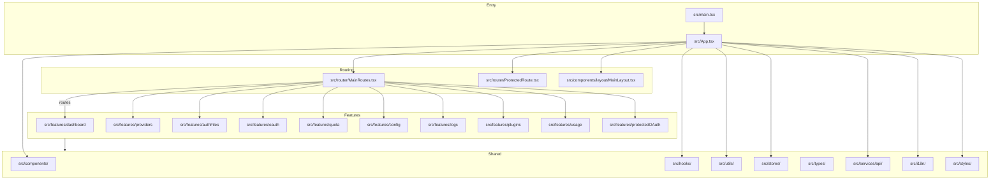

# CODE_GRAPH: CLI Proxy API Management Center

**Last Updated:** 2026-10-15  
**Purpose:** High-level structural map for AI agents and developers to understand the project architecture instantly and reduce file-reading overhead.

---

## Table of Contents
- [Visual Architecture](#visual-architecture)
- [Structured Code Graph Index](#structured-code-graph-index)
- [Data Flow Patterns & Architectural Invariants](#data-flow-patterns--architectural-invariants)
- [Gotchas & Pitfalls](#gotchas--pitfalls)
- [Testing Commands & Execution Workflows](#testing-commands--execution-workflows)
- [Quick Reference: Key Files by Task](#quick-reference-key-files-by-task)

---

## Visual Architecture

### Mermaid.js Diagram



### ASCII Overview

```
main.tsx
  └─> App.tsx
        ├─> router/MainRoutes.tsx
        │     └─> features/* (Dashboard, Providers, AuthFiles, OAuth, Quota, Config, Logs, Plugins, Usage, ProtectedOAuth)
        ├─> router/ProtectedRoute.tsx
        ├─> components/layout/MainLayout.tsx
        ├─> stores/
        ├─> services/api/
        ├─> components/
        ├─> hooks/
        ├─> utils/
        ├─> i18n/
        └─> styles/
```

---

## Structured Code Graph Index

### Entry Points

#### [src/main.tsx]
- **Role:** SPA entry point; sets up i18n, favicon, and renders `<App />` into the DOM.
- **Exports:** None (side-effect entry).
- **Dependencies:** App.tsx, i18n, assets/logoInline, styles/global.scss, react, react-dom.
- **Incoming References:** Vite/HTML entry.
- **Key Functions/Logic:**
  - Sets document title, disables translation, injects favicon.
  - Renders `<App />` inside `<I18nextProvider>` and `<StrictMode>`.

#### [src/App.tsx]
- **Role:** Root shell for routing, theme/language setup, update modal, and notification containers.
- **Exports:** Default App component.
- **Dependencies:** react-router-dom, pages/LoginPage, components/common, layout/MainLayout, router/ProtectedRoute, stores, services/api, utils/updateNotification.
- **Incoming References:** main.tsx.
- **Key Functions/Logic:**
  - `RootShell()`: Handles update notification logic once per document load after first successful connection.
  - `App()`: Initializes theme and language, sets document lang, renders HashRouter.

---

### Routing Layer

#### [src/router/MainRoutes.tsx]
- **Role:** Defines authenticated route table for the main app.
- **Exports:** `MainRoutes` component.
- **Dependencies:** react-router-dom, features/*, pages/*, stores.
- **Incoming References:** App.tsx.
- **Key Functions/Logic:**
  - `createMainRoutes(supportsPlugin)`: Returns route config array; conditionally includes plugin routes based on backend support.
  - `MainRoutes({ location })`: Uses Zustand `useAuthStore` to check plugin support, returns `useRoutes()`.

#### [src/router/ProtectedRoute.tsx]
- **Role:** Guards authenticated routes; redirects to `/login` if not authenticated.
- **Exports:** ProtectedRoute component.
- **Dependencies:** stores/useAuthStore, react-router-dom.
- **Incoming References:** App.tsx.

---

### Layout & Common Components

#### [src/components/layout/MainLayout.tsx]
- **Role:** Main layout wrapper for authenticated app (sidebar, header, outlet).
- **Exports:** MainLayout component.
- **Dependencies:** Shared UI components, Zustand stores, hooks, utils.
- **Incoming References:** App.tsx.

#### [src/components/common/*]
- **Role:** Shared common components (NotificationContainer, ConfirmationModal, UpdateModal, etc.).
- **Exports:** UI components.
- **Dependencies:** hooks, utils, stores, i18n.
- **Incoming References:** App.tsx, features, pages.

#### [src/components/ui/*]
- **Role:** Reusable UI primitives (Button, Modal, Input, etc.).
- **Exports:** UI primitives.
- **Dependencies:** styles, hooks, i18n.
- **Incoming References:** features, pages, common components.

---

### Features (Domain Modules)

#### [src/features/dashboard/*]
- **Role:** Dashboard page with metrics and system overview.
- **Exports:** DashboardPage component.
- **Dependencies:** components, hooks, utils, services/api, stores.
- **Incoming References:** MainRoutes.tsx.

#### [src/features/providers/*]
- **Role:** Provider workbench (AI provider config, testing, model management).
- **Exports:** ProvidersWorkbenchPage, provider descriptors, adapters.
- **Dependencies:** components, hooks, utils, services/api, stores, types.
- **Incoming References:** MainRoutes.tsx.
- **Key Files:**
  - `descriptors.ts`: Provider UI capabilities and metadata.
  - `adapters.ts`: Maps provider configs to shared resource model.

#### [src/features/authFiles/*]
- **Role:** Auth file management (credentials, OAuth, policies, cooldowns).
- **Exports:** AuthFilesPage component.
- **Dependencies:** components, hooks, utils, services/api, stores, types.
- **Incoming References:** MainRoutes.tsx.

#### [src/features/oauth/*]
- **Role:** OAuth provider gallery with tile-based UI and focused flow dialog.
- **Exports:** OAuthPage, ProviderTile, OAuthFlowDialog, VertexImportDialog, providers list.
- **Dependencies:** components, hooks, utils, services/api, stores, types, protectedOAuth.
- **Incoming References:** MainRoutes.tsx.
- **Key Files:**
  - `providers.ts`: Built-in OAuth provider definitions.
  - `OAuthPage.tsx`: Main OAuth gallery UI.
  - `OAuthFlowDialog.tsx`: Focused OAuth flow modal.

#### [src/features/protectedOAuth/*]
- **Role:** Protected OAuth provider definitions (Codex, Antigravity) that must never be removed.
- **Exports:** Protected provider definitions, IDs, helper functions.
- **Dependencies:** assets/icons, types.
- **Incoming References:** features/oauth.
- **Contract Tests:** `tests/protectedOAuthProviders.test.ts` (21 tests) enforces this feature.

#### [src/features/quota/*]
- **Role:** Quota management and monitoring for all providers.
- **Exports:** QuotaPage component, quota utilities.
- **Dependencies:** components, hooks, utils, services/api, stores, types.
- **Incoming References:** MainRoutes.tsx.

#### [src/features/usage/*]
- **Role:** Usage statistics and analytics.
- **Exports:** UsagePage component.
- **Dependencies:** components, hooks, utils, services/api, stores.
- **Incoming References:** MainRoutes.tsx.

#### [src/features/config/*]
- **Role:** Visual configuration editor (YAML-based config UI).
- **Exports:** ConfigPage component.
- **Dependencies:** components, hooks, utils, services/api, stores, types, codemirror.
- **Incoming References:** MainRoutes.tsx.

#### [src/features/logs/*]
- **Role:** Log viewer for backend error logs.
- **Exports:** LogsPage component.
- **Dependencies:** components, hooks, utils, services/api, stores.
- **Incoming References:** MainRoutes.tsx, pages/LogsPage.tsx (re-export).

#### [src/features/plugins/*]
- **Role:** Plugin management (install, configure, resource pages).
- **Exports:** PluginsPage, PluginStorePage, PluginResourcePage components.
- **Dependencies:** components, hooks, utils, services/api, stores, types.
- **Incoming References:** MainRoutes.tsx.

---

### Pages (Non-Feature Routes)

#### [src/pages/LoginPage.tsx]
- **Role:** Login page for management key authentication.
- **Exports:** LoginPage component.
- **Dependencies:** components, hooks, utils, stores, i18n.
- **Incoming References:** App.tsx.

#### [src/pages/SystemPage.tsx]
- **Role:** System information page (versions, backend info, manual update check).
- **Exports:** SystemPage component.
- **Dependencies:** components, hooks, utils, stores, services/api.
- **Incoming References:** MainRoutes.tsx.

#### [src/pages/AuthFilesOAuthExcludedEditPage.tsx]
- **Role:** Excluded model editor for auth file OAuth.
- **Exports:** AuthFilesOAuthExcludedEditPage component.
- **Dependencies:** components, hooks, utils, stores.
- **Incoming References:** MainRoutes.tsx.

#### [src/pages/AuthFilesOAuthModelAliasEditPage.tsx]
- **Role:** Model alias editor for auth file OAuth.
- **Exports:** AuthFilesOAuthModelAliasEditPage component.
- **Dependencies:** components, hooks, utils, stores.
- **Incoming References:** MainRoutes.tsx.

#### [src/pages/LogsPage.tsx]
- **Role:** Re-export of features/logs/LogsPage.
- **Exports:** LogsPage (re-export).
- **Dependencies:** features/logs.
- **Incoming References:** MainRoutes.tsx.

---

### State Management (Zustand Stores)

#### [src/stores/useAuthStore.ts]
- **Role:** Session state (authenticated, management key, server version, connection status, plugin support).
- **Exports:** useAuthStore hook.
- **Dependencies:** zustand, services/api, services/storage.
- **Incoming References:** App.tsx, ProtectedRoute, features, pages.
- **Key State:**
  - `isAuthenticated`, `managementKey`, `serverVersion`, `serverCommit`, `connectionStatus`, `supportsPlugin`.

#### [src/stores/useConfigStore.ts]
- **Role:** Configuration state with TTL cache and in-flight request deduplication.
- **Exports:** useConfigStore hook.
- **Dependencies:** zustand, services/api, types.
- **Incoming References:** features/config, features/providers, features/authFiles.
- **Key Functions:**
  - `fetchConfig(forceRefresh?: boolean)`: Full-config fetch with cache.
  - Cache invalidation on logout/connection switch.

#### [src/stores/useLanguageStore.ts]
- **Role:** i18n language state.
- **Exports:** useLanguageStore hook.
- **Dependencies:** zustand, i18n.
- **Incoming References:** App.tsx, components/layout.

#### [src/stores/useThemeStore.ts]
- **Role:** Theme state (light/dark/system).
- **Exports:** useThemeStore hook.
- **Dependencies:** zustand, utils.
- **Incoming References:** App.tsx, components/layout.

#### [src/stores/useUpdateStore.ts]
- **Role:** Update notification state (transient, per document load).
- **Exports:** useUpdateStore hook.
- **Dependencies:** zustand.
- **Incoming References:** App.tsx, pages/SystemPage.

#### [src/stores/useNotificationStore.ts]
- **Role:** Toast notification state.
- **Exports:** useNotificationStore hook.
- **Dependencies:** zustand.
- **Incoming References:** components/common/NotificationContainer, features.

#### [src/stores/useModelsStore.ts]
- **Role:** Model list state.
- **Exports:** useModelsStore hook.
- **Dependencies:** zustand, services/api.
- **Incoming References:** features/providers.

#### [src/stores/useQuotaStore.ts]
- **Role:** Quota state.
- **Exports:** useQuotaStore hook.
- **Dependencies:** zustand, services/api.
- **Incoming References:** features/quota.

---

### Services (API Layer)

#### [src/services/api/client.ts]
- **Role:** Centralized Management API client (prefix, bearer auth, error normalization, response-header handling).
- **Exports:** `apiClient` instance (axios wrapper).
- **Dependencies:** axios, stores/useAuthStore, utils.
- **Incoming References:** All domain API modules.
- **Key Features:**
  - Injects `Authorization: Bearer <MANAGEMENT_KEY>` header.
  - Emits `unauthorized`, `server-version-update`, `server-plugin-support-update` events.
  - Normalizes API errors.

#### [src/services/api/config.ts]
- **Role:** Config API (fetch, update, patch).
- **Exports:** `configApi` functions.
- **Dependencies:** client, transformers, types.
- **Incoming References:** stores/useConfigStore, features/config.

#### [src/services/api/providers.ts]
- **Role:** Provider API (list, test, model options).
- **Exports:** Provider API functions.
- **Dependencies:** client, transformers, types.
- **Incoming References:** features/providers, stores.

#### [src/services/api/authFiles.ts]
- **Role:** Auth file API (list, refresh, update policies).
- **Exports:** Auth file API functions.
- **Dependencies:** client, transformers, types.
- **Incoming References:** features/authFiles, stores.

#### [src/services/api/oauth.ts]
- **Role:** OAuth API (auth URL, status, callback, import).
- **Exports:** OAuth API functions.
- **Dependencies:** client, types.
- **Incoming References:** features/oauth.

#### [src/services/api/quota.ts]
- **Role:** Quota API (fetch quota for all providers).
- **Exports:** Quota API functions.
- **Dependencies:** client, types.
- **Incoming References:** features/quota, stores.

#### [src/services/api/logs.ts]
- **Role:** Logs API (fetch error logs).
- **Exports:** Logs API functions.
- **Dependencies:** client.
- **Incoming References:** features/logs.

#### [src/services/api/plugins.ts]
- **Role:** Plugin API (list, install, configure, resources).
- **Exports:** Plugin API functions.
- **Dependencies:** client, types.
- **Incoming References:** features/plugins.

#### [src/services/api/legacyBackendProbe.ts]
- **Role:** Detects outdated backend (v0) after v8 login 404; shows clearer error.
- **Exports:** `probeForLegacyBackend` function.
- **Dependencies:** axios.
- **Incoming References:** stores/useAuthStore.
- **Note:** Only sanctioned v0 touchpoint; never supplies application data or acts as login fallback.

#### [src/services/storage/secureStorage.ts]
- **Role:** Browser localStorage wrapper with lightweight obfuscation (`enc::v1::...`).
- **Exports:** Storage functions.
- **Dependencies:** utils/encryption.
- **Incoming References:** stores.
- **Note:** Reversible obfuscation, not encryption; not a security boundary.

---

### Types, Hooks, Utils, i18n, Styles

#### [src/types/*.ts]
- **Role:** Shared TypeScript types for API contracts, config, providers, plugins, quota, auth files, etc.
- **Exports:** Type definitions.
- **Key Files:** `api.ts`, `config.ts`, `provider.ts`, `authFile.ts`, `quota.ts`, `plugin.ts`, `visualConfig.ts`.

#### [src/hooks/*]
- **Role:** Shared React hooks (motion, localStorage, time, unsaved changes, visual config).
- **Key Hooks:** `motion.ts`, `useVisualConfig.ts`, `useLocalStorage.ts`, `useNow.ts`, `useUnsavedChangesGuard.ts`.

#### [src/utils/*]
- **Role:** Shared utilities (apiKey, constants, encryption, format, language, etc.).
- **Key Files:** `constants.ts`, `encryption.ts`, `format.ts`, `language.ts`, `updateNotification.ts`.

#### [src/i18n/*]
- **Role:** Internationalization setup and locale files (en, zh-CN, zh-TW, ru, vi, ko).
- **Files:** `index.ts`, `locales/en.json`, `locales/zh-CN.json`, etc.

#### [src/styles/*]
- **Role:** Global and modular SCSS styles, themes, variables.
- **Key Files:** `global.scss`, `themes.scss`, `variables.scss` (auto-injected by Vite).

---

## Data Flow Patterns & Architectural Invariants

### Primary Data Flows

#### Auth Flow
1. User enters management key and API address on LoginPage.
2. Auth state is stored in `useAuthStore`.
3. All API requests use `apiClient`, which injects the bearer token.
4. `ProtectedRoute` guards authenticated routes.

#### Config/State Flow
- `useConfigStore` fetches and caches full backend config (TTL, deduplication).
- Mutations update the store and invalidate caches.
- No section-based fetching; always use full-config fetch.

#### Update Notification Flow
1. Root shell mounted once per document load; hash navigation keeps it mounted.
2. After first successful connection, calls `versionApi.checkLatest()` once.
3. Compares backend-reported latest commit with connected server commit.
4. When newer commit available, `UpdateModal` renders.
5. Hash navigation **never** triggers automatic update check or opens notification.

#### OAuth Flow
- All OAuth results shown as modal (never toast), enforced by contract tests.
- Protected providers (Codex, Antigravity) must never be removed.
- OAuth flow dialog can be closed without interrupting authorization.

### Architectural Invariants

#### Single-file build
- Vite + `vite-plugin-singlefile` produces `dist/index.html` with all assets inlined.
- Hash routing required; no server-side routing.
- Releases rename `dist/index.html` to `management.html`.

#### API contract
- Only v8 Management API (`/v8/management/*`); no v0 fallback except legacy probe.
- All API modules build on `apiClient`.
- Plugin resources preserve backend-declared paths.

#### State management
- Zustand stores are single source of truth.
- Config store uses full-config fetch with TTL cache and in-flight deduplication.
- Cache invalidation on logout/connection switch.

#### i18n
- All user-facing text must be in all locale files (en, zh-CN, zh-TW, ru, vi, ko).
- Fallback language is `zh-CN`.

#### Protected features (owner mandate)
- **OAuth result modal:** Never remove, replace with toasts, or auto-dismiss. Enforced by `tests/oauthResultModal.test.ts`.
- **Protected OAuth providers (Codex, Antigravity):** Never remove or replace. Enforced by `tests/protectedOAuthProviders.test.ts`.
- **Update notification:** Single-show on initial document load only; never on hash navigation.

---

## Gotchas & Pitfalls

### Critical Rules (Break These = CI Failure)

- **Never remove or downgrade protected OAuth providers (Codex, Antigravity) or OAuth result modal.**  
  - Enforced by contract tests (`tests/protectedOAuthProviders.test.ts`, `tests/oauthResultModal.test.ts`).
  - Removing import from `@/features/protectedOAuth` in `OAuthPage.tsx` causes compilation error.

- **Never break single-file output or hash routing.**
  - Build must produce one `dist/index.html` with all assets inlined.
  - Router must use `createHashRouter`.

- **Never introduce v0 API fallbacks except in `src/services/api/legacyBackendProbe.ts`.**
  - Probe only shows clearer error; never supplies application data.

- **Always update all locale files for new/changed text.**
  - Missing translations show raw keys (e.g., `update_modal.title`).

### Common Mistakes

- **Do not commit credentials, management keys, auth files, or generated `dist/` output.**
- **Do not bypass `apiClient` for backend requests.**
- **Do not split config fetching by section; always use full-config fetch.**
- **Do not introduce another package manager's lockfile.** Use Bun 1.3.14.
- **Do not change protected features without explicit owner approval.**
- **Do not open update notification modal on hash navigation.**

### Performance & Security

- Config store uses TTL cache (5 min) and in-flight deduplication.
- Stale-request guards prevent old responses overwriting new session state.
- Management keys stored with lightweight obfuscation (`enc::v1::...`); not encryption.
- Never hardcode secrets; redact from logs, screenshots, fixtures.

---

## Testing Commands & Execution Workflows

### Quick Commands

```bash
# Install dependencies (frozen lockfile)
bun install --frozen-lockfile

# Run all tests
bun run test

# Run a single test file
bun test tests/apiError.test.ts

# Full verification (test + lint + build)
bun run verify

# Lint only
bun run lint

# Type check only
bun run type-check

# Format code
bun run format

# Dev server (http://localhost:5173 by default)
bun run dev

# Production build (outputs dist/index.html with inlined assets)
bun run build

# Preview built output
bun run preview
```

### Verification Workflow

Before committing or creating a PR:

1. **Format changed files:**
   ```bash
   bun run format
   ```

2. **Run verification:**
   ```bash
   bun run verify
   ```
   This runs:
   - `bun run test` (all Bun tests)
   - `bun run lint` (ESLint)
   - `bun run build` (TypeScript compilation + Vite build)

3. **Optional: Type check separately:**
   ```bash
   bun run type-check
   ```

4. **For UI changes: Verify in browser and include screenshots/notes in PR.**

### Test Organization

- **Location:** `tests/*.test.ts`
- **Framework:** Bun test (`bun:test`)
- **Fixtures:** `tests/fixtures/`
- **Helpers:** `tests/helpers/`

**Test Types:**
- Pure logic tests (utilities, transformers, validation)
- React SSR tests (static markup via `renderToStaticMarkup`)
- Source/contract checks (protected features, API contracts)

**No configured browser DOM test harness.** Static markup tests do not verify browser interactions.

### Protected Feature Contract Tests

These tests **must pass** and should never be modified without explicit owner approval:

- `tests/protectedOAuthProviders.test.ts` (21 tests)
  - Verifies Codex and Antigravity OAuth providers remain present.
  - Checks domain module exports, i18n keys, icon files, page rendering, API wiring.

- `tests/oauthResultModal.test.ts`
  - Verifies OAuth result modal feature is not removed, replaced, or downgraded.
  - Checks modal component, wiring, strict message rule, styles.

---

## Quick Reference: Key Files by Task

### Add a New API Endpoint
1. `src/services/api/<domain>.ts` (API module)
2. `src/features/<feature>/` (feature logic/UI)
3. `src/types/<domain>.ts` (types)
4. Update contract tests in `tests/` if needed

### Add/Edit a Feature Page
1. `src/features/<feature>/`
2. `src/router/MainRoutes.tsx` (if new route)
3. `src/components/` (shared UI if needed)
4. `src/types/` (types)
5. `src/stores/` (state if needed)
6. Update i18n in all locale files (en, zh-CN, zh-TW, ru, vi, ko)

### Change Config/State Logic
1. `src/stores/useConfigStore.ts`
2. `src/services/api/config.ts`
3. `src/features/config/`
4. `src/types/config.ts`

### Add/Edit OAuth Provider
1. `src/features/oauth/providers.ts`
2. `src/features/protectedOAuth/` (for protected providers)
3. `src/features/oauth/` (UI/logic)
4. Update contract tests and i18n

### Modify Provider Logic
1. `src/features/providers/descriptors.ts` (UI capabilities)
2. `src/features/providers/adapters.ts` (config mapping)
3. `src/services/api/providers.ts` (API)
4. `src/types/provider.ts` (types)

### Update Styles/Theme
1. `src/styles/` (global, themes, variables, etc.)
2. SCSS modules beside components/pages (e.g., `Component.module.scss`)

### Add/Edit i18n Text
1. `src/i18n/locales/en.json`
2. `src/i18n/locales/zh-CN.json`
3. `src/i18n/locales/zh-TW.json`
4. `src/i18n/locales/ru.json`
5. `src/i18n/locales/vi.json`
6. `src/i18n/locales/ko.json`

### Add/Edit Zustand Store
1. `src/stores/<storeName>.ts`
2. `src/stores/index.ts` (export)

### Add/Edit Shared Hook
1. `src/hooks/<hookName>.ts`

### Add/Edit Shared Utility
1. `src/utils/<utilName>.ts`

### Add/Edit Shared Component
1. `src/components/ui/<ComponentName>.tsx` (primitives)
2. `src/components/common/<ComponentName>.tsx` (common features)

---

## Self-Check & Maintenance

### Verification Checklist
- ✅ All entry points, routing, state, and API layers are mapped.
- ✅ Protected features and contract tests are documented.
- ✅ Architectural invariants (single-file build, hash routing, v8 API-only) are explicit.
- ✅ Gotchas and anti-patterns are documented.
- ✅ Testing commands and workflows are complete.
- ✅ Quick reference enables agents to minimize file reads/searches for common tasks.

### Maintenance Policy
- Update this document when:
  - New features or domains are added.
  - Routing or build configuration changes.
  - Protected features are added or modified (with owner approval).
  - Testing workflows change.
  - New architectural constraints are introduced.

- Keep this document in sync with:
  - `AGENTS.md` (repository guidance)
  - `ARCHITECTURE.md` (runtime composition)
  - `SPECIFICATION.md` (behavioral contracts)
  - `session.md` (current session context)

---

**This Code Graph is ready for persistent use by AI agents and automated developers.**
