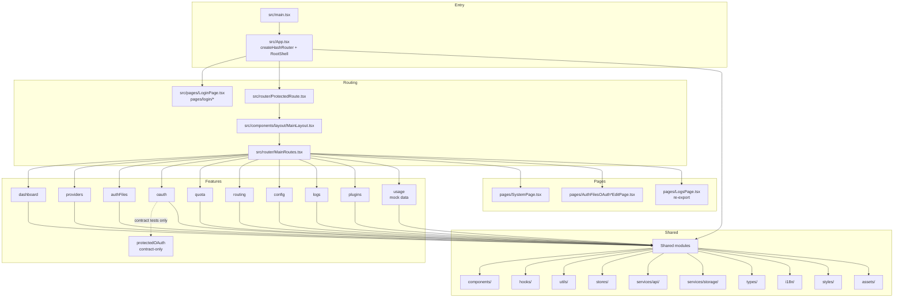

# CODE_GRAPH: CLI Proxy API Management Center

**Last Updated:** 2026-11-22
**Last Scanned Commit:** `ed47c53d22da7654bd3df63c1ac01a90e434b208`
**Scan Mode:** Incremental rescan after upstream merge
**Purpose:** High-level structural map for AI agents and developers to understand the project architecture instantly and reduce file-reading overhead.

---

## Table of Contents

- [Scan Metadata & Incremental Workflow](#scan-metadata--incremental-workflow)
- [Visual Architecture](#visual-architecture)
- [Structured Code Graph Index](#structured-code-graph-index)
- [Data Flow Patterns & Architectural Invariants](#data-flow-patterns--architectural-invariants)
- [Gotchas & Pitfalls](#gotchas--pitfalls)
- [Testing Commands & Execution Workflows](#testing-commands--execution-workflows)
- [Quick Reference: Key Files by Task](#quick-reference-key-files-by-task)
- [Self-Check & Maintenance](#self-check--maintenance)

---

## Scan Metadata & Incremental Workflow

This document is the persistent scan checkpoint for the repository. The hash above is the commit that was fully inspected for this version of the graph.

### Next scan

1. Read `Last Scanned Commit` from this file.
2. If the hash is missing or invalid, perform a full scan.
3. Otherwise, inspect only changes since that commit:

   ```bash
   git diff --name-only ed47c53d22da7654bd3df63c1ac01a90e434b208..HEAD -- \
     src tests package.json vite.config.ts tsconfig.json .github docs
   ```

4. Review the changed files, update only the affected sections of this graph, then replace `Last Scanned Commit` with the new `git rev-parse HEAD` value.
5. Do not advance the hash before the graph reflects the scanned commit.

### Scan scope for this revision

- Full source tree under `src/` and `tests/` at `7b9fcf7`, then incremental review of the upstream
  merge at `ed47c53` (payload replacement editor, visual-config rebase, model display names,
  discovery selection, and locale updates).
- Build/test configuration: `package.json`, `vite.config.ts`, `tsconfig.json`, `.github/workflows/`.
- All root and `docs/` Markdown files.
- Backend contract evidence was not re-fetched from `../CLIProxyAPI`; this scan maps the frontend as implemented and treats `AGENTS.md` plus source code as authoritative where older docs disagree.

---

## Visual Architecture

### Mermaid.js Diagram



### ASCII Overview

```
main.tsx
  └─> App.tsx (createHashRouter + RootShell)
        ├─> /login -> pages/LoginPage.tsx -> pages/login/*
        ├─> /* -> router/ProtectedRoute.tsx
        │         └─> components/layout/MainLayout.tsx
        │               └─> router/MainRoutes.tsx
        │                     ├─> features/dashboard
        │                     ├─> features/providers
        │                     ├─> features/authFiles
        │                     ├─> features/oauth
        │                     ├─> features/quota
        │                     ├─> features/routing
        │                     ├─> features/config
        │                     ├─> features/logs
        │                     ├─> features/plugins
        │                     ├─> features/usage
        │                     └─> pages/SystemPage + auth-file editors
        └─> RootShell overlays: NotificationContainer, ConfirmationModal,
              UpdateModal, LoginRevealVeil

Shared: components/, hooks/, utils/, stores/, services/api/,
        services/storage/, types/, i18n/, styles/, assets/

Dev-only: /__preview/quota-tiers is added only when import.meta.env.DEV is true
          and is dropped from the production single-file bundle.
```

---

## Structured Code Graph Index

### Entry Points

#### [src/main.tsx]

- **Role:** SPA entry point; sets document title/translation attributes, injects the inline favicon, and renders `<App />`.
- **Exports:** None (side-effect entry).
- **Dependencies:** `App.tsx`, `i18n`, `assets/logoInline`, `styles/global.scss`, React, React DOM.
- **Incoming References:** Vite/HTML entry.
- **Key Logic:** Wraps `App` in `<StrictMode>` and `<I18nextProvider>`.

#### [src/App.tsx]

- **Role:** Owns the hash router, root shell overlays, theme/language bootstrap, and automatic update check.
- **Exports:** Default `App` component.
- **Dependencies:** `react-router-dom`, `pages/LoginPage`, `components/common/*`, `components/layout/MainLayout`, `router/ProtectedRoute`, `stores`, `services/api`, `utils/updateNotification`.
- **Incoming References:** `main.tsx`.
- **Key Functions/Logic:**
  - `RootShell()`: renders notification/confirmation/update overlays and `<Outlet />`; performs one automatic update check per browser document after the first successful connection.
  - `createHashRouter([...])`: `/login` is public; `/*` is wrapped by `ProtectedRoute` and `MainLayout`.
  - `devPreviewRoutes`: dev-only `/__preview/quota-tiers` lazy route; statically false in production.
  - `App()`: initializes theme, syncs i18n language, sets `document.documentElement.lang`, renders `RouterProvider`.

---

### Routing Layer

#### [src/router/MainRoutes.tsx]

- **Role:** Authenticated route table rendered inside `MainLayout`.
- **Exports:** `MainRoutes` component.
- **Dependencies:** `react-router-dom`, all feature pages, auth-file editor pages, `pages/SystemPage`, `useAuthStore`.
- **Incoming References:** `components/layout/MainLayout.tsx`.
- **Routes:**
  - Dashboard: `/`, `/dashboard`.
  - Providers: `/quick-start` (fixed `apikeyFun` brand), `/ai-providers`.
  - Auth files: `/auth-files`, `/auth-files/oauth-excluded`, `/auth-files/oauth-model-alias`.
  - OAuth: `/oauth`.
  - Routing: `/routing`.
  - Quota: `/quota`; Usage: `/usage`; Logs: `/logs`; Config: `/config`; System: `/system`.
  - Plugin routes are conditional on `useAuthStore.supportsPlugin`: `/plugins`, `/plugins?view=store` via `/plugin-store` redirect, and `/plugin-pages/:pluginId/:menuIndex`.
  - Legacy aliases `/settings` and `/api-keys` redirect to `/config`; unknown routes redirect to `/`.
  - Plugin paths redirect to `/` when the backend does not advertise plugin support.

#### [src/router/ProtectedRoute.tsx]

- **Role:** Guards authenticated routes; redirects unauthenticated users to `/login` with the original location in router state.
- **Exports:** `ProtectedRoute`.
- **Dependencies:** `useAuthStore`, `react-router-dom`, `router/loginRedirect`.
- **Incoming References:** `App.tsx`.

#### [src/router/loginRedirect.ts]

- **Role:** Defines `LoginRedirectState` and `resolveLoginRedirect(state)`; prevents redirecting back to `/login`.
- **Incoming References:** `ProtectedRoute.tsx`, `pages/LoginPage.tsx`.

#### [src/router/index.tsx]

- **Role:** Placeholder comment only. The real router is created in `App.tsx`.

---

### Layout & Shared Components

#### [src/components/layout/MainLayout.tsx]

- **Role:** Authenticated shell: sidebar, header actions, theme/language menus, page transitions, global refresh, and route outlet.
- **Exports:** `MainLayout`.
- **Dependencies:** UI components, `PageTransition`, `MainRoutes`, `authFilesApi`, `pluginsApi`, stores, plugin resources, provider sponsor helpers, header refresh, constants.
- **Incoming References:** `App.tsx` via `ProtectedRoute`.
- **Key Logic:**
  - Sidebar groups: `operate`, `gateway`, `observe`, `control`, plus dynamic `plugin-pages`.
  - Quick-start item moves between `operate` and `gateway` depending on `hasApiKeyFunConfig(config)`.
  - Loads plugin resource entries and auth-file count with stale-request guards and refresh events.
  - `handleRefreshAll()` clears config cache, force-refetches config, reloads plugin resources/auth-file count, and triggers header refresh handlers.
  - Keyboard sidebar toggle via `utils/sidebarShortcut`; accessible rail tooltips and ARIA labels.

#### [src/components/common/*]

- **Role:** Cross-page overlays and transition helpers.
- **Key Files:** `NotificationContainer.tsx`, `ConfirmationModal.tsx`, `UpdateModal.tsx`, `OAuthResultModal.tsx`, `LoginRevealVeil.tsx`, `PageTransition.tsx`, `PageTransitionLayer.ts`, `notificationTimer.ts`, `updateChangelog.ts`.
- **Incoming References:** `App.tsx`, `MainLayout.tsx`, feature pages.
- **Notes:** `OAuthResultModal` is protected but currently not wired into the OAuth page; see Gotchas.

#### [src/components/ui/*]

- **Role:** Reusable UI primitives and small helpers.
- **Key Files:** `Button.tsx`, `Card.tsx`, `Input.tsx`, `Modal.tsx`, `Select.tsx`, `ToggleSwitch.tsx`, `AutocompleteInput.tsx`, `EmptyState.tsx`, `LoadingSpinner.tsx`, `FieldLabel.tsx`, `icons.tsx`, `selectPosition.ts`, `scrollLock.ts`, `cardLayout.ts`, and `Collapsible/`, `Sheet/`, `Skeleton/`, `Table/`, `Tooltip/`.
- **Incoming References:** Features, pages, layout, common components.

#### [src/components/excludedModels/*], [src/components/modelAlias/*], [src/components/providers/*]

- **Role:** Shared domain UI that is used by more than one feature but not promoted to generic UI primitives.
- **Examples:** excluded-model rules/picker, model-alias mapping diagram, provider status bar, sensitive-replacement editor, recent-request hook.

---

### Features (Domain Modules)

#### [src/features/dashboard/*]

- **Role:** Dashboard overview: connection status, version/build metadata, traffic metrics, provider/credential counts, and quick links.
- **Exports:** `DashboardPage`.
- **Key Files:** `DashboardPage.tsx`, `hooks/useDashboardOverview.ts`, `components/LiveWire.tsx`, `components/Meter.tsx`, `components/Sparkline.tsx`, `components/ThroughputChart.tsx`, `utils.ts`, `types.ts`.
- **Dependencies:** stores, `authFilesApi`, shared UI, motion hooks, format utils.

#### [src/features/providers/*]

- **Role:** Provider workbench for keys, headers, proxies, model mappings, sponsor providers, and connectivity tests.
- **Exports:** `ProvidersWorkbenchPage`, descriptors, adapters, provider helpers.
- **Key Files:** `descriptors.ts` (UI capabilities), `adapters.ts` (config-to-resource mapping), `useProviderWorkbench.ts`, `ProvidersWorkbenchPage.tsx`, `sheets/`, `sponsor*.ts`, `aiCodeMirror.ts`, `modelEntries.ts`, `errorRules.ts`, `thinkingLevels.ts`, `discoverySelection.ts`.
- **Dependencies:** `providersApi`, `modelsApi`, `apiCallApi`, config store, shared UI, types.
- **Incoming References:** `MainRoutes.tsx` for `/ai-providers` and `/quick-start`.

#### [src/features/authFiles/*]

- **Role:** Credential vault: upload/download/delete, filtering, sorting, refresh, cooldowns, credential policy, model rules, and inline quota sections.
- **Exports:** `AuthFilesPage`, event helpers, cache invalidation, identity/logic/ui-state helpers.
- **Key Files:** `AuthFilesPage.tsx`, `components/`, `hooks/`, `modelRules/`, `authFilesEvents.ts`, `cacheInvalidation.ts`, `credentialPolicy.ts`, `cooldowns.ts`, `identity.ts`, `logic.ts`, `manualRefresh.ts`, `oauthEditorState.ts`, `uiState.ts`.
- **Dependencies:** `authFilesApi`, `modelsApi`, quota adapters, stores, shared UI.
- **Incoming References:** `MainRoutes.tsx`, `MainLayout.tsx` (count badge), `pages/AuthFilesOAuth*EditPage.tsx`.

#### [src/features/oauth/*]

- **Role:** OAuth gallery with provider tiles, focused flow dialog, plugin OAuth entries, sponsor cards, Vertex import, SIWC binding, and background authorization continuation.
- **Exports:** `OAuthPage`, provider card definitions, flow hooks.
- **Key Files:** `OAuthPage.tsx`, `providers.ts`, `components/OAuthHeader.tsx`, `components/ProviderTile.tsx`, `components/OAuthFlowDialog.tsx`, `components/VertexImportDialog.tsx`, `components/SiwcBindDialog.tsx`, `components/SponsorCard.tsx`, `components/LoginProxyField.tsx`, `hooks/useOAuthFlows.ts`, `hooks/useVertexImport.ts`, `callbackUrl.ts`, `devinOAuth.ts`, `loginProxy.ts`, `oauthAttempts.ts`, `siwcBinding.ts`.
- **Dependencies:** `oauthApi`, `vertexApi`, `pluginsApi`, `authFilesApi`, stores, shared UI, provider sponsor helpers.
- **Incoming References:** `MainRoutes.tsx`.

#### [src/features/protectedOAuth/*]

- **Role:** Contract-only domain module for the owner-mandated Codex and Antigravity OAuth providers.
- **Exports:** `PROTECTED_OAUTH_PROVIDER_DEFINITIONS`, `PROTECTED_OAUTH_PROVIDER_IDS`, `PROTECTED_WEBUI_PROVIDER_IDS`, `PROTECTED_CALLBACK_PROVIDER_IDS`, `isProtectedOAuthProvider`, and the definition type.
- **Dependencies:** `assets/icons/antigravity.svg`, `assets/icons/codex.svg`.
- **Incoming References:** `tests/protectedOAuthProviders.test.ts` only. It is not imported by runtime source at this commit.
- **Enforcement:** `tests/protectedOAuthProviders.test.ts` checks the domain module, locale keys, icon files, OAuth provider source, API source, and page source.

#### [src/features/quota/*]

- **Role:** Quota cards and timelines for Antigravity, Claude, Codex, Devin, Kimi, Meta, plugin quotas, and xAI.
- **Exports:** `QuotaPage`, `QUOTA_ADAPTERS`, quota logic/UI helpers.
- **Key Files:** `QuotaPage.tsx`, `providers/index.ts` (adapter registry), `providers/<provider>/data.ts` and `*QuotaBody.tsx`, `hooks/useQuotaBatchLoader.ts`, `hooks/useQuotaActions.ts`, `cardTier.ts`, `resetSchedule.ts`, `quotaTimelineModel.ts`, `preview/QuotaTierPreview.tsx`.
- **Dependencies:** `authFilesApi`, `apiCallApi`, provider-specific API modules, `useQuotaStore`, `utils/quota/*`, shared UI.
- **Incoming References:** `MainRoutes.tsx`; `features/authFiles` uses the same adapter registry for inline quota sections.

#### [src/features/routing/*]

- **Role:** Routing priority board: drag-and-drop tiers, member weights, policies, change review, and save plan.
- **Exports:** `RoutingPage`.
- **Key Files:** `RoutingPage.tsx`, `logic.ts`, `format.ts`, `useDragAutoScroll.ts`, `components/TierLadder.tsx`, `components/WeightDialog.tsx`, `components/PolicyPanel.tsx`, `components/ChangeReviewDialog.tsx`, `components/RoutingSaveBar.tsx`.
- **Dependencies:** `services/api/routing.ts`, `types/routing.ts`, config/auth stores, shared UI, `useUnsavedChangesGuard`, `useHeaderRefresh`, shared clock.
- **Save Contract:** Builds a local draft plan, writes credentials one by one, patches config once, then reloads the board so partial failures are visible.
- **Incoming References:** `MainRoutes.tsx`.

#### [src/features/config/*]

- **Role:** Visual and YAML configuration editor with search, validation, diff preview, and draft recovery.
- **Exports:** `ConfigPage`, config UI/state helpers.
- **Key Files:** `ConfigPage.tsx`, `hooks/useConfigDocument.ts`, `hooks/useFieldJump.ts`, `hooks/useSourceSearch.ts`, `components/`, `sections/`, `visualConfig*.ts`, `apiKeyNames.ts`, `searchIndex.ts`, `sponsors.ts`, `uiState.ts`, `types.ts`.
- **Dependencies:** `configFileApi`, `configPatch`, `apiClient`, `useVisualConfig`, CodeMirror, config/theme/notification stores.
- **Incoming References:** `MainRoutes.tsx`.

#### [src/features/logs/*]

- **Role:** Log workspace with incremental tail, search/filter, management-traffic hiding, fullscreen, error-log viewer, and downloads.
- **Exports:** `LogsPage`.
- **Key Files:** `LogsPage.tsx`, `hooks/useLogStream.ts`, `hooks/useLogFilters.ts`, `hooks/useLogScroller.ts`, `model/logBuffer.ts`, `model/logSelectors.ts`, `model/logRequests.ts`, `model/errorLogViewer.ts`, `model/logFullscreen.ts`.
- **Dependencies:** `logsApi`, config/auth/notification stores, shared UI, clipboard/download utils.
- **Incoming References:** `MainRoutes.tsx`, `pages/LogsPage.tsx` (re-export).

#### [src/features/plugins/*]

- **Role:** Installed-plugin management, plugin store views, plugin resource pages, status, versions, logos, and OAuth entries.
- **Exports:** `PluginsPage`, `PluginResourcePage`, plugin helpers.
- **Key Files:** `PluginsPage.tsx`, `PluginResourcePage.tsx`, `pluginsView.ts`, `pluginResources.ts`, `pluginStoreEntries.ts`, `pluginStatus.ts`, `pluginConfigDraft.ts`, `pluginLogo.ts`, `pluginPolling.ts`, `pluginReleaseVersions.ts`, `pluginSearch.ts`, `hooks/`.
- **Dependencies:** `pluginsApi`, `pluginStoreApi`, `apiCallApi`, auth store, shared UI.
- **Incoming References:** `MainRoutes.tsx` (gated), `MainLayout.tsx` (dynamic sidebar resources), `features/oauth` (plugin OAuth entries).

#### [src/features/usage/*]

- **Role:** Usage & analytics page with a React Flow topology diagram and static overview cards.
- **Exports:** `UsagePage`.
- **Key Files:** `UsagePage.tsx`, `components/FlowTopology.tsx`, `components/nodes/RouterNode.tsx`, `components/nodes/ProviderNode.tsx`, `components/edges/ElectricEdge.tsx`.
- **Dependencies:** `reactflow`, `useHeaderRefresh`, local SCSS.
- **Current Limitation:** Uses mock provider data and hard-coded English copy; no backend usage API is wired at this commit.
- **Incoming References:** `MainRoutes.tsx`.

---

### Pages (Non-Feature Routes)

#### [src/pages/LoginPage.tsx]

- **Role:** Management-key login, auto-login splash, localized error mapping, language selection, and redirect restoration.
- **Exports:** `LoginPage`, `LoginPhase`, `LOGIN_BRAND_NAME`.
- **Dependencies:** `useAuthStore`, `useLanguageStore`, `useNotificationStore`, `useLoginTransitionStore`, `Select`, `DotMatrixHero`, `LoginForm`, `resolveLoginRedirect`, `LegacyBackendError`.
- **Incoming References:** `App.tsx`.

#### [src/pages/login/*]

- **Role:** Login presentation split into `DotMatrixHero.tsx`, `dotMatrixField.ts`, `LoginForm.tsx`, `_palette.scss`, and their SCSS modules.
- **Incoming References:** `pages/LoginPage.tsx`.

#### [src/pages/SystemPage.tsx]

- **Role:** System information, manual update check, model catalog, request-log toggle, local login-data clearing, and repository links.
- **Exports:** `SystemPage`.
- **Dependencies:** `apiClient`, `configApi`, `modelsApi`, `versionApi`, stores, `useApiKeysForModels`, `resolveUpdateAvailability`, `updateChangelog`, icons.
- **Incoming References:** `MainRoutes.tsx`.

#### [src/pages/AuthFilesOAuthExcludedEditPage.tsx]

- **Role:** Full-page editor for auth-file OAuth excluded-model rules.
- **Dependencies:** `authFilesApi`, shared excluded-model components, stores.
- **Incoming References:** `MainRoutes.tsx`.

#### [src/pages/AuthFilesOAuthModelAliasEditPage.tsx]

- **Role:** Full-page editor for auth-file OAuth model aliases.
- **Dependencies:** `authFilesApi`, shared model-alias components, stores.
- **Incoming References:** `MainRoutes.tsx`.

#### [src/pages/LogsPage.tsx]

- **Role:** Re-export shim: `export { LogsPage } from '@/features/logs/LogsPage'`.
- **Incoming References:** `MainRoutes.tsx`.

---

### State Management (Zustand Stores)

#### [src/stores/useAuthStore.ts]

- **Role:** Session state, login/logout, auto-login restore, server version/build/commit, plugin support, and connection status.
- **Key State:** `isAuthenticated`, `apiBase`, `managementKey`, `rememberPassword`, `serverVersion`, `serverBuildDate`, `serverCommit`, `supportsPlugin`, `connectionStatus`.
- **Key Logic:** Clears config/models/quota caches on login and logout; probes a legacy backend only after a v8 config 404; listens for `unauthorized`, `server-version-update`, `server-commit-update`, and `server-plugin-support-update` events.
- **Persistence:** `cli-proxy-auth` via `obfuscatedStorage`; pre-v2 credentials are discarded rather than migrated.

#### [src/stores/useConfigStore.ts]

- **Role:** Full-config cache with TTL, in-flight deduplication, and stale-request guards.
- **Key Functions:** `fetchConfig(forceRefresh?)`, `updateConfigValue(section, value)`, `clearCache(section?)`, `isCacheValid()`.
- **Cache:** `CACHE_EXPIRY_MS = 30 * 1000`; one full-config cache, not section-based fetching.
- **Stale Guard:** `configRequestToken` invalidates in-flight responses after connection switch, logout, or refresh.

#### [src/stores/useModelsStore.ts]

- **Role:** Model list cache and fetch state.
- **Incoming References:** `SystemPage`, provider model discovery, auth-file model catalog sync.

#### [src/stores/useQuotaStore.ts]

- **Role:** Route-surviving quota cache for all quota providers and Codex credit-overage operations.
- **Key Helpers:** `captureQuotaCacheGeneration(name?)`, `commitIfQuotaCacheCurrent(generation, commit, name?)`.
- **Stale Guard:** Global `cacheGeneration` plus per-file `fileGenerations` prevent old quota responses from overwriting newer session state.

#### [src/stores/useNotificationStore.ts]

- **Role:** Toast notifications and confirmation-modal state.
- **Incoming References:** `NotificationContainer`, `ConfirmationModal`, features, pages.

#### [src/stores/useThemeStore.ts]

- **Role:** Theme selection (`auto`, `white`, `light`, `dark`) and resolved theme.
- **Incoming References:** `App.tsx`, `MainLayout.tsx`, features.

#### [src/stores/useLanguageStore.ts]

- **Role:** Active language and i18n synchronization.
- **Incoming References:** `App.tsx`, `MainLayout.tsx`, `LoginPage.tsx`.

#### [src/stores/useUpdateStore.ts]

- **Role:** Transient update info and modal open state; reset per browser document load.
- **Incoming References:** `App.tsx`, `SystemPage.tsx`.

#### [src/stores/useLoginTransitionStore.ts]

- **Role:** Login reveal phase (`idle`/`revealing`), reveal id, and reduced-motion-aware timings.
- **Incoming References:** `LoginPage.tsx`, `MainLayout.tsx`, `LoginRevealVeil.tsx`.

#### [src/stores/index.ts]

- **Role:** Barrel exports for all stores, including quota cache-generation helpers.

---

### Services (API & Storage Layer)

#### [src/services/api/client.ts]

- **Role:** Centralized axios client for the v8 Management API.
- **Exports:** `apiClient`.
- **Key Features:**
  - `MANAGEMENT_API_PREFIX` is `/v8/management`; domain modules use paths relative to that base.
  - Injects `Authorization: Bearer <MANAGEMENT_KEY>` and JSON content type.
  - Default timeout `REQUEST_TIMEOUT_MS = 30 * 1000`; `setConfig()` can override it.
  - Reads version/build/commit/plugin-support headers and dispatches `server-version-update`, `server-commit-update`, and `server-plugin-support-update` events.
  - Dispatches `unauthorized` on HTTP 401; normalizes errors through `apiError.ts`.
  - `getConnectionRevision()` and `captureConnection(isCurrent?)` pin credentials and suppress response side effects after connection changes.

#### [src/services/api/apiCall.ts]

- **Role:** Generic proxied request helper via `/requests/api-call`; normalizes status/header/body and exposes `captureApiCallApi()`.
- **Incoming References:** Provider connectivity tests, quota providers, plugin release checks, sponsor usage checks.

#### [src/services/api/config.ts], [configFile.ts], [configPatch.ts], [configValue.ts]

- **Role:** Full config read, raw `config.yaml` read/write, config patch planning/application, and connection-guarded config reads.
- **Incoming References:** `useConfigStore`, `features/config`, `features/routing`, `SystemPage`.

#### [src/services/api/providers.ts], [providerModels.ts], [transformers.ts]

- **Role:** Provider group reads/writes, model option normalization, and backend-field normalization/serialization.
- **Incoming References:** `features/providers`, `features/config`, `useModelsStore`.

#### [src/services/api/authFiles.ts], [authFileCooldowns.ts], [authFilePolicyAdapter.ts]

- **Role:** Credential list/upload/download/delete, status/fields patches, refresh, cooldown reset, model verification, OAuth excluded models/aliases, and credential policy adaptation.
- **Incoming References:** `features/authFiles`, `features/oauth`, `features/quota`, `MainLayout`, auth-file editor pages.

#### [src/services/api/oauth.ts], [vertex.ts]

- **Role:** OAuth auth URL/status/callback/cancel, SIWC binding, built-in provider IDs, and Vertex import.
- **Incoming References:** `features/oauth`.

#### [src/services/api/logs.ts]

- **Role:** Incremental `/observability/logs` reads, clear, error-log listing/download, and response-to-text normalization.
- **Incoming References:** `features/logs`.

#### [src/services/api/plugins.ts]

- **Role:** Installed plugins, plugin enable/config/delete, plugin store entries, and backend-declared install/update paths.
- **Incoming References:** `features/plugins`, `MainLayout`, `features/oauth`, plugin quota adapter.

#### [src/services/api/routing.ts]

- **Role:** Routing board normalization, plan building, credential writes, config patch generation, and `RoutingConflictError`.
- **Incoming References:** `features/routing`.

#### [src/services/api/models.ts], [version.ts], [apiKeys.ts], [apiKeyUsage.ts]

- **Role:** Model catalog, latest-version check, client API-key replacement, and API-key usage snapshots.
- **Incoming References:** `SystemPage`, `useModelsStore`, dashboard, provider recent-request stats.

#### [src/services/api/antigravitySubscription.ts], [claudeUsage.ts], [claudeResetGrants.ts], [devinQuota.ts], [kimiQuota.ts], [metaQuota.ts]

- **Role:** Provider-specific quota/subscription parsing and request helpers.
- **Incoming References:** `features/quota/providers/*`.

#### [src/services/api/legacyBackendProbe.ts]

- **Role:** Sanctioned v0 touchpoint. Exports `LegacyBackendError` and `probeLegacyBackend(apiBase, managementKey)`; called only after a v8 login config fetch returns 404.
- **Constraint:** Never supplies application data and is never a login fallback.

#### [src/services/api/apiError.ts], [src/services/api/index.ts]

- **Role:** Error response parsing and a barrel that re-exports the common API surface. Some modules are imported directly by path.

#### [src/services/storage/secureStorage.ts]

- **Role:** `obfuscatedStorage` wrapper around localStorage using `utils/encryption`.
- **Note:** Reversible obfuscation (`enc::v1::...`), not encryption or a security boundary.

---

### Types, Hooks, Utils, i18n, Styles, Assets

#### [src/types/*]

- **Role:** Shared TypeScript contracts.
- **Files:** `common.ts`, `api.ts`, `config.ts`, `auth.ts`, `provider.ts`, `authFile.ts`, `oauth.ts`, `quota.ts`, `plugin.ts`, `index.ts`, `style.d.ts`.
- **Direct-import modules:** `routing.ts` and `visualConfig.ts` are consumed directly by routing/config code rather than through `types/index.ts`.

#### [src/hooks/*]

- **Role:** Shared React hooks.
- **Files:** `motion.ts`, `useActionBarHeightVar.ts`, `useApiKeysForModels.ts`, `useEdgeSwipeBack.ts`, `useHeaderRefresh.ts`, `useInterval.ts`, `useLocalStorage.ts`, `useMediaQuery.ts`, `useNow.ts`, `useUnsavedChangesGuard.ts`, `useVisualConfig.ts`.
- **Motion helpers:** `prefersReducedMotion`, `useRevealOnScroll`, `useRevealGroup`, `useCountUp`.

#### [src/utils/*]

- **Role:** Pure helpers for connection URLs, constants, encryption, formatting, language, models, provider keys, recent requests, sidebar shortcuts, timestamps, validation, and update availability.
- **Key Files:** `connection.ts`, `constants.ts`, `encryption.ts`, `format.ts`, `language.ts`, `models.ts`, `updateNotification.ts`, `sidebarShortcut.ts`.
- **Subdirectories:** `utils/quota/*` (parsers, resolvers, formatters, reset instants, plan tiers, xAI paid detection), `utils/time/*` (durations, shared clock, timezone).

#### [src/i18n/*]

- **Role:** i18next setup and locale catalogs.
- **Locales:** `en`, `zh-CN`, `zh-TW`, `ru`, `vi`, `ko`, `tr`.
- **Fallback:** `zh-CN`; initial language comes from `utils/language.getInitialLanguage()`.

#### [src/styles/*]

- **Role:** Global styles and theme tokens.
- **Files:** `global.scss`, `themes.scss`, `variables.scss`, `components.scss`, `layout.scss`, `mixins.scss`, `reset.scss`.
- **Build Note:** Vite auto-injects `variables.scss` into SCSS modules; modules should not re-import it.

#### [src/assets/*]

- **Role:** Bundled logo (`logoInline.ts`) and provider/OAuth icons under `icons/`.
- **Build Note:** Assets must remain inlineable for the single-file output.

---

## Data Flow Patterns & Architectural Invariants

### Primary Data Flows

#### Auth Flow

1. `LoginPage` collects API base, management key, and remember-password choice.
2. `useAuthStore.login()` normalizes the base, configures `apiClient`, clears config/models/quota caches, and fetches full config to verify the connection.
3. A v8 config 404 may trigger `probeLegacyBackend`; that probe only produces a clearer legacy-backend error.
4. On success, auth state becomes `connected`; response headers update version/build/commit/plugin support through client events.
5. `ProtectedRoute` guards `/*`; `logout` clears client credentials, caches, and persisted login state.

#### Config Flow

- `useConfigStore.fetchConfig(forceRefresh?)` is the single full-config read path with a 30-second TTL and in-flight deduplication.
- `configRequestToken` prevents stale responses from overwriting state after connection switches, logout, or refresh.
- Visual editing uses `useVisualConfig` plus `features/config/visualConfig*.ts`; YAML/source editing uses `configFileApi`; saves use `configPatch`.
- There is no section-based config fetching. `clearCache(section?)` invalidates the full cache while optionally preserving the current snapshot.

#### API Client Flow

- Domain modules call `apiClient`; components should not issue ad hoc Management API requests.
- `apiClient` injects bearer auth, normalizes errors, emits session events, and applies a 30-second default timeout.
- Long-running or connection-sensitive operations use `captureConnection()`, `captureApiCallApi()`, `captureSiwcBindingApi()`, or quota cache-generation guards.

#### Update Notification Flow

1. `RootShell` mounts once per browser document; hash navigation keeps it mounted.
2. After the first `connected` status, `shouldCheckInitialUpdate()` permits exactly one `versionApi.checkLatest()` call.
3. `resolveUpdateAvailability()` compares semantic version segments only; commit hashes are display metadata and never trigger the modal.
4. `UpdateModal` opens only when the upstream version is newer; `SystemPage` can invoke the same check manually.
5. Hash-route changes never trigger an automatic check or reopen the modal.

#### OAuth Flow

- `OAuthPage` combines built-in cards from `features/oauth/providers.ts` with plugin OAuth entries.
- Clicking a tile opens `OAuthFlowDialog`; closing the dialog does not cancel authorization, and tile status continues updating.
- Vertex import and SIWC binding use dedicated dialogs; login proxy and callback helpers live in the feature.
- `OAuthResultModal` remains protected by contract tests, but the current page uses inline status in `OAuthFlowDialog`; re-integration is an explicit TODO.

#### Routing Flow

- `RoutingPage` builds a local `RoutingDraft` from `buildRoutingBoard()`.
- `logic.ts` computes a `RoutingPlan`; `ChangeReviewDialog` shows the pending change.
- Saving writes credentials one by one, patches config once, and reloads the board even after partial failure.

#### Quota Flow

- `QuotaPage` lists auth files and delegates each provider to `QUOTA_ADAPTERS`.
- Each adapter pairs a React-free `data.ts` with a `*QuotaBody.tsx` renderer and a `useQuotaStore` slice.
- `captureQuotaCacheGeneration()` / `commitIfQuotaCacheCurrent()` prevent stale quota responses from landing after credential mutations.

#### Plugin Flow

- `supportsPlugin` comes from the backend plugin-support response header.
- Routes, sidebar entries, and plugin resource pages are gated by that flag.
- Plugin resource paths and custom install/update paths remain backend-declared; the UI does not rewrite them into v8 Management paths.

### Architectural Invariants

#### Single-file build

- Vite + `vite-plugin-singlefile` produce one `dist/index.html` with JS, CSS, and assets inlined.
- Hash routing via `createHashRouter` is required; releases rename `dist/index.html` to `management.html`.
- `vite.config.ts` disables code splitting and sets `assetsInlineLimit` high enough for bundled assets.
- The dev-only quota preview route must stay out of production output.

#### API contract

- Only the v8 Management API (`/v8/management`) supplies application data.
- `legacyBackendProbe.ts` is the sole v0 touchpoint and only diagnoses an outdated backend after a v8 login 404.
- All Management requests go through `apiClient` or a domain module built on it.

#### State management

- Zustand stores are the single source of truth for session, config, models, quota, notifications, theme, language, update state, and login transition.
- Config uses full-config TTL caching and in-flight deduplication; quota uses generation guards; auth clears caches on session changes.

#### i18n

- Seven locales are registered: `en`, `zh-CN`, `zh-TW`, `ru`, `vi`, `ko`, `tr`; fallback is `zh-CN`.
- User-facing text and accessible labels belong in every locale file.

#### Protected features

- OAuth result modal component, styles, and contract test must not be removed or downgraded.
- Codex and Antigravity OAuth definitions and their contract suite must not be removed or replaced.
- Update notification must remain single-show on initial document load and version-based only.

---

## Gotchas & Pitfalls

### Critical Rules

- **Do not reintroduce the retired navigation entry.** `tests/navigationRemoval.test.ts` asserts that the route, sidebar item, locale keys, and feature directory are absent.
- **Do not remove protected OAuth provider contracts.** `src/features/protectedOAuth/` is contract-only at this commit; runtime cards live in `src/features/oauth/providers.ts`, and both are checked by `tests/protectedOAuthProviders.test.ts`.
- **Do not remove or downgrade `OAuthResultModal`.** It is currently not integrated with the OAuth page; the contract test has a TODO for re-integration. Do not claim modal results are currently shown.
- **Do not trigger update checks on hash navigation.** Availability is semantic-version based; commit hashes are display metadata only.
- **Do not break single-file output or hash routing.** No external build artifacts and no browser-history routing.
- **Do not add v0 API fallbacks.** The only v0 call is the legacy probe after a v8 404.
- **Do not bypass `apiClient` for Management API requests.** Use a domain module or an existing capture helper.
- **Do not split config fetching by section.** The store caches the full config for 30 seconds.
- **Do not update only some locale files.** All seven locales are registered.

### Stale Documentation Discovered in This Scan

- `docs/management-api.md` still describes `/v0/management`, a v7 version floor, and a Live Flow WebSocket that has no source implementation. Treat it as historical; `AGENTS.md` and source are authoritative.
- `docs/SPECIFICATION.md` still says four locales and that `OAuthPage.tsx` imports the protected OAuth domain. The code has seven locales and the protected domain is contract-only.
- `CONTRIBUTING.md` still says Bun 1.3.14 and four locales. `package.json`, CI, and `AGENTS.md` use Bun 1.4.3 and seven locales.
- `docs/USAGE_FEATURE.md` describes the usage topology as a completed feature; the page still uses mock data and hard-coded English copy.
- These discrepancies were recorded in `session.md` rather than silently changing protected-feature specifications during a documentation scan.

### Common Mistakes

- Looking for the router in `src/router/index.tsx`; it is a placeholder. The router is in `App.tsx`.
- Treating `src/pages/LogsPage.tsx` as an implementation; it is a one-line re-export.
- Assuming a five-minute config TTL; the current constant is 30 seconds.
- Assuming `probeForLegacyBackend` exists; the export is `probeLegacyBackend`.
- Adding a `liveFlow` feature because an older API doc mentions `/live-flow/ws`; no such source exists at this commit.
- Committing generated `dist/` output, credentials, management keys, or auth files.

### Performance & Security

- Config cache: 30-second TTL plus in-flight deduplication and request-token invalidation.
- Quota cache: generation guards for global and per-file invalidation.
- API client: 30-second default timeout and connection-revision pinning.
- Management keys are obfuscated in browser storage; this is not encryption or a security boundary.
- Never hardcode secrets; redact them from logs, screenshots, and fixtures.

---

## Testing Commands & Execution Workflows

### Quick Commands

```bash
# Install dependencies (frozen lockfile)
bun install --frozen-lockfile

# Dev server (http://localhost:5173 by default)
bun run dev

# Run all tests
bun run test

# Focused checks used for this scan
bun test tests/navigationRemoval.test.ts \
  tests/updateNotification.test.ts \
  tests/protectedOAuthProviders.test.ts \
  tests/oauthResultModal.test.ts

# Lint / type check / build
bun run lint
bun run type-check
bun run build

# Full verification (test + lint + build)
bun run verify

# Format source files
bun run format

# Preview built output
bun run preview
```

### Toolchain Notes

- `package.json` pins `bun@1.4.3`; CI uses Node.js 24 and Bun 1.4.3.
- The local runner during this scan reported Bun 1.4.2; focused tests and type checking still passed.
- Tests use `bun:test`; fixtures live in `tests/fixtures/` and helpers in `tests/helpers/`.
- There is no browser DOM test harness. React tests use `renderToStaticMarkup`; source/contract tests inspect files directly.

### Verification Workflow

1. Format changed source files with `bun run format`.
2. Run focused tests for the touched domain.
3. Run `bun run verify` before handoff.
4. For UI changes, verify the affected route in a browser and include screenshots or notes.
5. For documentation-only changes, validate content/diff and run focused checks where useful.

### Known Full-Suite State

- The last recorded full verification in `session.md` was `2402 pass, 1 todo, 19 fail`; the failures were reproduced on unmodified `HEAD` and are unrelated to the retired navigation entry.
- This scan did not re-run the full suite. It ran the four focused suites above: `40 pass, 1 todo, 0 fail`.
- The single TODO is OAuth result modal re-integration with the current OAuth page architecture.

---

## Quick Reference: Key Files by Task

### Rescan This Code Graph

1. Read `Last Scanned Commit` at the top of this file.
2. Run `git diff --name-only <hash>..HEAD -- src tests package.json vite.config.ts tsconfig.json .github docs`.
3. Update affected sections, then set `Last Scanned Commit` to the new `git rev-parse HEAD`.

### Add a New API Endpoint

1. `src/services/api/<domain>.ts` and export it from `src/services/api/index.ts` when appropriate.
2. `src/types/<domain>.ts` or `src/types/api.ts`.
3. Feature hook/component under `src/features/<feature>/`.
4. Add or update a focused test in `tests/`.

### Add or Change a Route

1. `src/router/MainRoutes.tsx`.
2. `src/components/layout/MainLayout.tsx` for sidebar navigation.
3. `tests/navigationRemoval.test.ts` if a route is intentionally retired.
4. All seven locale files for labels and accessible names.

### Add/Edit a Feature Page

1. `src/features/<feature>/`.
2. `src/router/MainRoutes.tsx` if it is routable.
3. `src/components/` only for genuinely shared UI.
4. `src/stores/` if new global state is required.

### Change Config/State Logic

1. `src/stores/useConfigStore.ts`.
2. `src/services/api/config.ts`, `configFile.ts`, `configPatch.ts`, `configValue.ts`.
3. `src/features/config/` and `src/hooks/useVisualConfig.ts`.
4. `src/types/config.ts` and `src/types/visualConfig.ts`.

### Modify Provider Logic

1. `src/features/providers/descriptors.ts` for UI capabilities.
2. `src/features/providers/adapters.ts` for config mapping.
3. `src/services/api/providers.ts` and `providerModels.ts`.
4. `src/types/provider.ts`.

### Add/Edit OAuth Provider

1. `src/features/oauth/providers.ts` for built-in cards.
2. `src/features/protectedOAuth/` only for owner-mandated protected definitions.
3. `src/services/api/oauth.ts` for provider IDs and endpoints.
4. `tests/protectedOAuthProviders.test.ts` and all seven locale files.

### Modify Routing Board

1. `src/features/routing/logic.ts` for plan computation.
2. `src/features/routing/RoutingPage.tsx` for UI orchestration.
3. `src/services/api/routing.ts` for normalization and writes.
4. `src/types/routing.ts`.

### Modify Quota Behavior

1. `src/features/quota/providers/index.ts` for the adapter registry.
2. `src/features/quota/providers/<provider>/data.ts` for data access.
3. `src/stores/useQuotaStore.ts` for cache/generation behavior.
4. `src/utils/quota/*` for parsing and formatting.

### Modify Plugin Behavior

1. `src/features/plugins/` for UI and plugin helpers.
2. `src/services/api/plugins.ts` for endpoints.
3. `src/components/layout/MainLayout.tsx` for dynamic resource navigation.
4. Preserve backend-declared resource and install paths.

### Update Styles/Theme

1. `src/styles/` for global tokens and shared styles.
2. SCSS modules beside the component/page.
3. `src/hooks/motion.ts` for reduced-motion-aware behavior.

### Add/Edit i18n Text

1. `src/i18n/locales/en.json`.
2. `src/i18n/locales/zh-CN.json`.
3. `src/i18n/locales/zh-TW.json`.
4. `src/i18n/locales/ru.json`.
5. `src/i18n/locales/vi.json`.
6. `src/i18n/locales/ko.json`.
7. `src/i18n/locales/tr.json`.

### Add/Edit Store, Hook, Utility, Component

1. Store: `src/stores/<storeName>.ts` plus `src/stores/index.ts`.
2. Hook: `src/hooks/useName.ts`.
3. Utility: `src/utils/<name>.ts` or the relevant `utils/quota|time` subdirectory.
4. Component: `src/components/ui/` for primitives, `src/components/common/` for shared overlays, or the owning feature directory.

---

## Self-Check & Maintenance

### Verification Checklist

- ✅ Entry points, hash router, route table, layout, features, pages, stores, services, types, hooks, utils, i18n, styles, and assets are mapped.
- ✅ Current commit hash and incremental scan command are recorded.
- ✅ Retired navigation entry is documented as absent and contract-enforced.
- ✅ Protected OAuth providers and OAuth result modal status are documented accurately.
- ✅ Update notification is documented as semantic-version based with commit hashes as display metadata.
- ✅ Single-file build, v8-only API, 30-second config TTL, and stale-request guards are explicit.
- ✅ Stale documentation discrepancies are recorded rather than silently changing protected specs.

### Current Scan Result

- **Scanned commit:** `7b9fcf7a98ce89ec1fb71e4644b1bb5744c36fdc`.
- **Mode:** Full scan; no prior hash existed in this document.
- **Focused tests:** `bun test tests/navigationRemoval.test.ts tests/updateNotification.test.ts tests/protectedOAuthProviders.test.ts tests/oauthResultModal.test.ts` — 40 pass, 1 todo, 0 fail.
- **Type check:** `bun run type-check` — pass.
- **Full suite:** Not re-run during this documentation scan; last recorded result is in `session.md`.

### Maintenance Policy

Update this document when:

- A feature, route, sidebar group, or page is added or removed.
- Routing, build configuration, deployment output, or toolchain versions change.
- API contracts, client events, cache TTLs, or stale-request guards change.
- Protected features or their contract tests change.
- Locale registration or testing workflows change.
- A new architectural constraint is introduced.

Keep this document in sync with `AGENTS.md`, `docs/ARCHITECTURE.md`, `docs/SPECIFICATION.md`, `CHANGELOG.md`, and `session.md`. When older documents disagree with source, record the discrepancy in `session.md` and treat `AGENTS.md` plus source as authoritative unless the owner decides otherwise.

---

**This Code Graph is the current structural checkpoint for AI agents and automated developers.**
